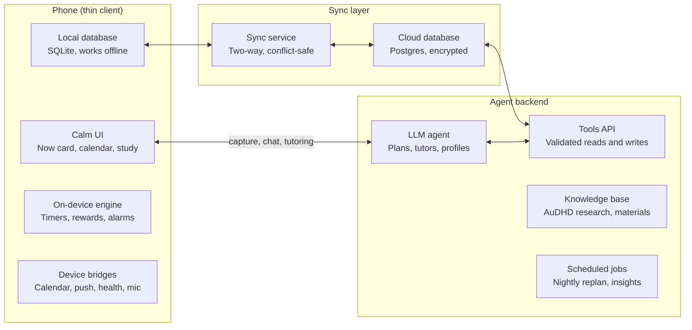

# Prism — AuDHD Executive-Function Companion: Design Document

Oct 31, 2026 · @Guy Peled

## 1. Overview

Prism is a mobile companion that acts as an external executive function for AuDHD and ADHD adults: it decides *what to do next, how small to make it, and how to make starting it feel rewarding*, so the user does not have to. The app is a thin, calm client over a synced database; nearly all reasoning (planning, breaking down, adapting, tutoring, profiling) is delegated to an LLM agent.

**Problem.** Most productivity apps assume a working executive system: they store tasks and expect the user to plan, prioritise, start and sustain effort. For AuDHD people those are exactly the failing steps. The result is the familiar cycle: install, over-organise, feel shame at the red overdue list, abandon.

**Target users.** Adults (16+) with diagnosed or self-identified ADHD, autism, or both (AuDHD). Primary persona: a student or knowledge worker facing a deadline (an exam, a project) who knows *what* matters but cannot reliably get from intention to action.

**Core jobs the app does for the user**

1. Turn a vague goal or a pile of material into a sequence of tiny, concrete, startable steps.
2. Pick the single next step that fits the user's *current* energy, sensory load and time.
3. Make starting and finishing feel good immediately, not someday.
4. Learn the user over time and adapt, without ever shaming them.
5. When the goal is learning, teach the material directly inside the app.

**Design principles**

- **One thing at a time.** The home screen shows one next action, not a list. Lists exist but are one tap away.
- **Externalise, don't instruct.** The app holds time, memory and sequence so the user's working memory does not have to.
- **Interest is the fuel.** Use the interest-based nervous system (novelty, challenge, urgency, passion) deliberately, rather than importance-based motivation.
- **Predictable surface, novel content.** The autistic side needs a stable, predictable UI and routines; the ADHD side needs novelty. Keep layout and rules fixed; vary the content, framing and rewards.
- **No shame, ever.** No red overdue counters, no broken-streak punishments, no guilt copy. Missed is just rescheduled.
- **Low demand language.** Offer, don't command ("Want to try 5 minutes of X?") to reduce demand-avoidance responses.
- **Calm by default.** Minimal motion, muted palette, sensory settings first-class. Rewards are bright but brief.
- **The user is the authority.** Every inference the LLM makes about the user is visible, explained and editable.

## 2. Knowledge foundation

Every dimension in Prism maps to an established construct from ADHD, autism or AuDHD research, so profiles and interventions are explainable and not invented. The table lists each construct, its source, and the product mechanism it drives. Sources are cited from memory and should be verified by a clinical advisor before launch.

| Construct | Origin | What it means for the user | What Prism does about it |
| --- | --- | --- | --- |
| Executive function as self-regulation | Barkley's EF model (inhibition, working memory, self-motivation, emotional self-regulation, planning) | The gap is between knowing and doing, at the point of performance | Puts cues, time and next step at the point of performance (the home card, nudges) |
| Six EF clusters | Brown model: activation, focus, effort, emotion, memory, action | Different people struggle in different clusters | The trait profile scores each cluster separately (section 3) |
| Interest-based nervous system | Dodson; often summarised as INCUP (Interest, Novelty, Challenge, Urgency, Passion) | Importance alone does not produce action | Each task is framed with an interest hook; the LLM picks the hook that works for this user |
| Time blindness / temporal discounting | Barkley; delay-aversion research (Sonuga-Barke) | Future deadlines feel unreal until they are urgent | Visual time (shrinking bars), artificial near-deadlines, immediate rewards |
| Task initiation / "wall of awful" | Clinical ADHD coaching literature (Brendan Mahan) | Starting costs more than doing; emotional residue from past failures | First step under 2 minutes, "just open the file" steps, body doubling |
| Monotropism | Murray, Lesser and Lawson (2005) | Attention flows into few channels deeply; switching is costly | Protect focus tunnels, warn before transitions, batch similar tasks |
| Hyperfocus | ADHD and autism literature | Strong asset that can overrun needs and deadlines | Gentle "surfacing" check-ins, hyperfocus harnessed for high-value tasks |
| Autistic burnout | Raymaker et al. (2020) | Chronic overload leads to loss of skills and capacity for weeks or months | Burnout risk tracking, automatic load reduction, "maintenance mode" |
| Spoon / energy accounting | Spoon theory (Miserandino), used widely by autistic and chronically ill communities | Capacity is finite and varies daily | Daily energy budget; tasks carry an energy cost |
| Sensory processing differences | Autism diagnostic criteria (DSM-5-TR); sensory profile research | Noise, light, texture affect capacity | Sensory load in the state profile; calm UI; environment suggestions |
| Emotional dysregulation and RSD | Barkley (deficient emotional self-regulation); RSD is a clinical, not diagnostic, term | Criticism or failure hits hard and stops action | Shame-free copy, no failure framing, celebrating partial progress |
| Demand avoidance (PDA profile) | Newson; ongoing research on pathological / persistent demand avoidance | Direct demands trigger resistance, even for wanted tasks | Choice-based phrasing, "pick one of three", user can switch demand style |
| Interoception | Autism and ADHD interoception research (e.g. Garfinkel) | Hunger, thirst, fatigue are noticed late | Body check nudges tied to state check-ins |
| Masking / camouflaging | Hull et al. (2017) | Social masking drains energy invisibly | Social events carry an energy cost and recovery buffer |
| Working memory limits | Both ADHD and autism EF research | Multi-step instructions get lost | Every step is self-contained; never more than one instruction per card |
| Need for predictability | Autism criteria (insistence on sameness) | Surprise changes cause distress | Plan changes are announced, explained, and confirmable; stable routines |
| Dopamine and reward timing | Reward-deficiency and delay-aversion models of ADHD | Delayed rewards do not motivate | Rewards at completion, within seconds |

The LLM receives this table (expanded into a structured knowledge base, see section 9) as grounding, so its explanations to the user cite the construct by name: "This looks like a transition cost, common with monotropic attention."

## 3. Evolving trait profile

The trait profile is a slowly changing model of *how this person's brain works*, built from onboarding, behaviour and reflections; it is shown as a character sheet of strengths and friction points, never as a diagnosis or deficit score.

**Presentation.** A "character sheet" with a constellation visual. Each trait is a star with a brightness (strength) and a short, plain-language description written by the LLM for this user. Challenges are framed as "friction points" with the workaround the app uses for each.

**Trait dimensions** (each scored 0 to 100 with a confidence value)

| Group | Trait | Strength pole | Friction pole | Evidence signals |
| --- | --- | --- | --- | --- |
| Activation | Task initiation | Starts readily | Stalls before starting | Time from task shown to task started |
| Activation | Transition cost | Switches easily | Switching drains | Abandonment right after context changes |
| Focus | Attention style | Flexible, wide | Monotropic, deep | Session length, interruption tolerance |
| Focus | Hyperfocus tendency | Deep flow, high output | Overruns needs and deadlines | Sessions far over planned length |
| Effort | Sustained effort on low-interest tasks | Can grind | Needs hooks | Completion rate by interest rating |
| Time | Time estimation | Accurate | Optimistic or blind | Estimated vs actual duration |
| Time | Urgency dependence | Self-starts early | Acts only near deadline | Work distribution before deadlines |
| Memory | Working memory load | Holds multi-step plans | Needs one step at a time | Success rate vs step size |
| Emotion | Frustration / RSD sensitivity | Resilient to setbacks | Setbacks stop momentum | Drop-off after a missed or failed task |
| Motivation | Interest drivers | Weights for novelty, challenge, urgency, passion, social | (profile, not a scale) | Which framing preceded completion |
| Motivation | Demand sensitivity | Direct instructions fine | Demands trigger avoidance | Response to imperative vs choice phrasing (A/B) |
| Sensory | Sensory sensitivity by channel (sound, light, touch, social) | Tolerant | Easily overloaded | Check-ins, environment notes |
| Energy | Social / masking cost | Social energises | Social drains | Energy after social events |
| Energy | Burnout vulnerability | Stable capacity | Capacity crashes | Rolling energy trend, sleep, load |
| Routine | Need for predictability | Enjoys spontaneity | Needs routines and warnings | Reaction to plan changes |
| Strengths | Special interests, pattern recognition, creativity, justice sense, honesty, crisis performance | Always strengths | (none) | Onboarding, reflections, completed projects |

**How the profile evolves**

1. **Seed.** A 5-minute onboarding: short, game-like scenarios ("You have an essay due in 3 days. Pick what usually happens.") rather than clinical questionnaires. Optional import of self-reported diagnoses and medication timing.
2. **Observe.** Every app event (task shown, started, abandoned, completed, rescheduled, check-in) is logged with context: time, state, framing used, step size.
3. **Infer.** A nightly LLM job reads the day's events plus the current profile and proposes *trait updates* with evidence ("Started 4 of 5 tasks framed as challenges, 1 of 5 framed as importance → raise challenge weight"). Updates are small (bounded, e.g. at most 5 points per week) to keep the profile stable and trustworthy.
4. **Confirm.** Weekly, the user sees a short "What I learned about you" card and can accept, reject or edit each insight. Rejected inferences are stored so the LLM does not repeat them.
5. **Act.** The profile is part of the context for every planning and nudging decision (step size, framing, timing, reward type).

**Levelling.** Traits do not "level up" by changing who you are. What levels up are *skills and supports*: e.g. "Transition ritual: level 3, used 21 times". This rewards building scaffolding instead of implying the user must become neurotypical.

## 4. Current state profile

The current state is a fast-changing snapshot (hours, not weeks) that decides *what kind* of task the user can do right now; a good plan for a depleted brain is a different plan.

**State dimensions**

| Dimension | Scale | Captured by | Used for |
| --- | --- | --- | --- |
| Energy (spoons) | 0 to 10 spoons left today | Check-in, decays with completed tasks by their cost | Filtering tasks by energy cost |
| Focus capacity | Scattered / Okay / Locked-in | Check-in, recent session behaviour | Step size and session length |
| Mood / emotional load | 5 faces + optional word | Check-in | Tone of copy, whether to suggest recovery |
| Sensory load | Calm / Buzzing / Overloaded | Check-in, optional ambient noise sensor | Suggest quieter tasks, offer environment changes |
| Social battery | 0 to 5 | Check-in, calendar social events | Avoid scheduling calls after draining events |
| Body basics | Ate / drank / moved / slept (toggles) | One-tap body check | Interoception nudges before work |
| Medication window (optional) | Active / wearing off / none | Logged dose time + user-set duration | Put hard tasks in the active window |
| Time context | Free minutes until next fixed event | Calendar | Fit tasks to the available gap |
| Burnout risk | Low / Rising / High | Derived: 7-day energy trend, overload count, sleep | Triggers maintenance mode |

**Check-in UX.** A 10-second, three-swipe check-in (energy, focus, sensory), offered at app open if the last one is older than 3 hours. It is never required: if skipped, the LLM estimates state from time of day, recent activity and history, and says so ("Guessing you're medium energy; tap to correct").

**State-aware modes** (chosen by the LLM, shown as the app's colour mood)

- **Flow mode** (high energy, locked-in): bigger chunks, fewer interruptions, hyperfocus guard on.
- **Steady mode** (default): normal micro-steps, standard nudges.
- **Low-battery mode** (low energy or high sensory load): only tasks tagged low-effort or "maintenance"; suggests one tiny win, then rest.
- **Maintenance mode** (burnout risk high): pauses non-essential goals, renegotiates deadlines where possible, focuses on basics and recovery, celebrates rest as a completed task.
- **Overwhelm button**: always visible. One tap hides everything except one calming action and one optional micro-step.

## 5. Planning system

Planning is a four-level hierarchy, Quest → Milestone → Task → Step, where the user writes only the top levels in their own words and the LLM generates and continuously re-plans everything below.

| Level | Example | Size | Who creates it | Where it shows |
| --- | --- | --- | --- | --- |
| Quest (big project / goal) | "Pass the statistics exam" | Weeks to months | User, in free text or voice | Quest map |
| Milestone | "Understand hypothesis testing" | Days to a week | LLM, user can edit | Quest map, calendar |
| Task | "Learn what a p-value means" | 15 to 60 min | LLM | Today list |
| Step | "Read this 3-sentence definition and tap Got it" | 1 to 10 min | LLM, generated just in time | Now card |

**Capture.** One input box, everywhere: type or speak anything ("dentist thursday 3pm, also need to finish the slides before Monday, and I want to learn guitar"). The LLM classifies each fragment as event, deadline, task or quest, asks at most one clarifying question, and files it. Capture must take under 5 seconds so ideas are not lost to working memory.

**Calendar.** Fixed events (appointments, classes) are imported from device calendars and shown as solid blocks. Deadlines are shown as markers with a visible "time runway" bar that shrinks. Flexible tasks are never pinned to exact times by default; they are placed into *windows* (morning, afternoon, evening) to avoid the shame of a missed 10:00 slot. Each event carries an energy cost and a transition buffer (e.g. 15 minutes before and after, longer for social events, per profile).

**Daily plan.** Each morning (or at first open) the LLM builds "Today" from: hard events, deadlines and their runway, quest milestones, current state and the trait profile. Rules it follows:

- Plan to about 60% of available time; time blindness and transitions eat the rest.
- At most 3 "main" tasks per day; extras go to a "bonus" shelf.
- Hardest task in the user's best window (learned, or the medication window).
- Similar tasks batched to reduce switching (monotropism).
- Every task starts with a step that takes under 2 minutes.

**Now card.** The home screen shows a single card: the next step, why it matters (the interest hook), estimated minutes, and three buttons: *Start*, *Smaller* (LLM splits it further), *Not now* (pick another, no penalty). "Smaller" can be pressed repeatedly until the step is as small as "open the document".

**Re-planning.** Missed tasks are not "overdue"; the LLM silently re-plans and, if a deadline is at risk, shows one calm card with options ("Cut scope", "Ask for extension (draft email)", "Add a focus block tomorrow"). Any change to the visible plan is announced, because unannounced change is distressing for autistic users.

**Support tools in the task flow**

- **Body doubling:** a virtual co-working companion (avatar, or optional live rooms with others working silently).
- **Visual timers:** shrinking-colour timers instead of digits.
- **Transition rituals:** a 60-second wind-down/wind-up card between tasks, with a 5-minute warning before fixed events.
- **Hyperfocus guard:** gentle "surface" check after planned duration plus a margin, never a hard stop.

## 6. Study mode

Study mode turns uploaded learning material and an exam date into a daily plan of 2 to 10 minute learning steps that are completed *inside the app*, so the user never has to face a 200-page PDF and decide where to begin.

**Pipeline**

1. **Ingest.** User adds material: PDFs, slides, photos of notes or textbook pages (OCR), web links, lecture recordings (transcribed), past exams, the syllabus. Plus the exam date and, optionally, how confident they feel per topic.
2. **Map.** The LLM builds a *knowledge map*: topics → concepts → atomic facts/skills, with prerequisites between them and an exam-weight estimate (from syllabus, past exams, emphasis in material). Each concept stores source passages so every question can cite where its answer came from.
3. **Diagnose (optional).** A 5-minute playful placement quiz marks concepts as known, shaky or new, so time is not wasted on known material.
4. **Schedule.** Working back from the exam date: new concepts in prerequisite order, spaced reviews of earlier ones (FSRS-style spaced repetition), and 2 to 3 full practice sessions in the final week. A buffer of about 20% of days is left empty for bad days. Study steps are merged into the daily plan with everything else.
5. **Learn.** Each step is one interactive micro-lesson (below).
6. **Adapt.** Results update concept mastery; the schedule re-plans nightly. If the user falls behind, the LLM cuts by exam weight ("Skip chapter 7, it's 3% of past exams") rather than cramming.

**Micro-lesson formats** (the LLM picks by concept type, state and profile)

| Format | Length | Best for | Low-energy friendly |
| --- | --- | --- | --- |
| Bite card: 2 to 4 sentence explanation + one check question | 1 to 2 min | New facts and definitions | Yes |
| Recall flashcard (spaced repetition) | Seconds each, 5 to 10 per set | Reviews | Yes |
| "Explain it back" (type or voice; LLM gives feedback) | 3 to 5 min | Deep understanding (Feynman technique) | No |
| Worked example → faded example → solo problem | 5 to 10 min | Procedures, math | No |
| Socratic tutor chat, scoped to one concept | 5 min, capped | Confusion, "why" questions | Medium |
| Interest-bridged analogy (uses the user's special interests) | 2 min | Hard abstract concepts | Yes |
| Boss battle: timed mixed quiz | 10 min | End of milestone, exam practice | No |
| Audio mode: listen and answer by voice | 5 min | Walking, stimming, low visual tolerance | Yes |

**Learning-science basis.** Retrieval practice, spaced repetition, interleaving, worked examples and elaborative interrogation are all well-supported by cognitive psychology (e.g. Dunlosky et al., 2013). Prism uses them because they also happen to fit ADHD: short, active, immediately scored.

**Grounding and accuracy.** The tutor answers only from the user's material plus general knowledge flagged as such. Each lesson shows a "source" link to the passage. Users can flag a wrong question in one tap; flagged items are regenerated and down-weighted.

**Example daily study plan** (7 days to exam, steady state, 45 minutes of study budget)

- [ ] 2 min: Warm-up, 5 flashcards from yesterday
- [ ] 4 min: Bite card, "What a p-value is (and isn't)"
- [ ] 3 min: Explain p-value back in your own words
- [ ] 8 min: Worked example, one-sample t-test
- [ ] Break: 5 min, move or snack
- [ ] 6 min: Faded example, two-sample t-test
- [ ] 2 min: Analogy card linking to your interest (e.g. football stats)
- [ ] 10 min: Mini boss, mixed quiz on week 1 topics
- [ ] 2 min: Close-out, rate confidence, see XP and map progress

## 7. Gamification and reward design

Rewards fire within one second of any completed step, scale with *effort relative to today's state* rather than raw output, and never take anything away; the game layer is a thin, quiet frame around real work, not a second app to manage.

**Reward loop per step:** tap Done → short haptic + sound + colour burst (under 1.5 s) → XP number rises → the next step's card slides in (momentum). The burst can be toned down to haptic-only in sensory settings.

**Mechanics**

| Mechanic | How it works | Why it fits AuDHD | Guardrail |
| --- | --- | --- | --- |
| Effort XP | XP = base × difficulty for *you today* (an initiation on a low-energy day earns more) | Rewards the real cost: starting, not just output | Capped per day to discourage over-exertion |
| Starting bonus | Extra XP just for pressing Start | Initiation is the hardest step | None needed |
| Quest map | Each quest is a visual path; milestones light up as nodes | Makes far goals visible (time blindness) | One map per quest, no social comparison |
| Momentum, not streaks | A "momentum" meter that fills with activity and *slowly* drains; never resets to zero, and rest days are protected | Streak loss is a classic ADHD abandonment trigger | No streak counters anywhere |
| Surprise drops | Occasional random bonus (cosmetic item, a fun fact about a special interest) | Novelty and variable reward feed the interest system | Cosmetic only, low frequency, no loot boxes, no purchases |
| Companion | A small creature/plant that grows with completed steps and reflects state (rests when you rest) | Externalised, non-judgemental feedback; body-double feel | It never gets sick, sad or dies from neglect |
| Skill badges for supports | "Transition ritual lvl 3", "Asked for help", "Took a rest day" | Rewards scaffolding and self-care, not masking | Badges are private by default |
| Boss battles | End-of-milestone quizzes or hard tasks with a clear finish | Challenge and urgency (INCUP) | Optional, can be retried freely |
| Real-world rewards | User lists real treats; the app "unlocks" one after a milestone | Bridges app rewards to genuine dopamine | User-defined, never purchasable |

**Distraction budget.** The game layer must not become the hyperfocus target. Rules:

- No feeds, no social leaderboard, no infinite content.
- Companion and cosmetics live on one secondary screen; the home screen is just the Now card.
- Celebration animations are short and skippable; after a session ends, the app suggests closing itself.
- Time spent in non-task screens is tracked, and if it grows, the LLM tones the game layer down.
- Notifications never advertise rewards ("come collect your bonus") to pull the user in.

**Anti-shame rules for copy and visuals.** No red for overdue items. No "you failed", "you missed", "behind". Partial completion is completion ("You did 2 of 5 steps, that's 2 more than zero"). Returning after a long absence gets a warm welcome back and a fresh, small plan, never a backlog.

## 8. Nudges, notifications and colour

Prism sends few, well-timed, choice-based nudges (default cap: 6 per day) whose timing and wording are chosen by the LLM from the user's state and history, and it treats notification fatigue as a failure mode to measure, not a cost of doing business.

**Nudge types**

| Type | Trigger | Example copy | Default |
| --- | --- | --- | --- |
| Start nudge | Planned window opens and user is idle | "Got 5 minutes? Next tiny step: open the slides." (with Start / Later buttons) | On |
| Transition warning | 10 and 3 minutes before a fixed event | "Dentist in 10 min. Good moment to save and grab your keys." | On |
| Leave-now alert | Travel time to event (location optional) | "Leave in 5 minutes to arrive calm." | On |
| Surface check | Planned session length + 20% exceeded | "You've been deep for 70 min. Water? Keep going?" | On |
| Body check | Long gap since last food/water log, before study blocks | "Quick fuel check before you start?" | Off (opt-in) |
| Runway nudge | Deadline runway crosses a threshold | "Essay due in 5 days. One 10-min step today keeps it easy." | On |
| Wind-down | Evening, user-set time | "Want to set tomorrow's first step? It makes mornings easier." | On |
| Welcome back | No activity for 3+ days | "Hey, good to see you. Here's one small thing, no backlog." | On |

**Adaptive rules**

- The LLM learns which nudge times and phrasings lead to a Start (bandit-style experiment per user) and stops sending what is ignored.
- Ignored nudges reduce frequency automatically; three ignored in a row triggers a "too many?" check instead of another nudge.
- Quiet hours, focus-mode integration (iOS Focus / Android DND) and a "pause everything for X hours" switch.
- Every nudge is actionable from the lock screen (Start / Snooze 15 / Skip) so the user does not have to open the app and get lost.
- Escalation is optional and user-designed (e.g. a louder alarm only for leave-now on flagged events).
- Channels beyond phone, opt-in: smartwatch haptic taps (low-distraction), widget, optional message to an accountability buddy.

**Colour system.** Colour encodes *state and category*, never failure.

| Use | Colours | Notes |
| --- | --- | --- |
| App mood (current state) | Flow = deep teal, Steady = soft blue, Low-battery = warm amber, Maintenance = lavender | Whole UI tint shifts gently so the user sees their state at a glance |
| Life areas (user-chosen) | Up to 6 hue tags, e.g. study, work, home, health, social, fun | Calendar blocks and task chips; user can rename and recolour |
| Energy cost | 1 to 3 dots, not colour | Avoids overloading hue meaning |
| Time runway | Bar that fills with a single calm hue as time passes | No red; urgency shown by bar length, not alarm colour |
| Rewards | Saturated, brief colour bursts | The only bright colour in the app, so it is distinctive |

Accessibility: WCAG AA contrast, colour-blind-safe palettes, every colour paired with an icon or label, a low-stimulation theme (greyscale + one accent), reduced motion, and dyslexia-friendly font option.

## 9. Architecture

Prism is local-first: the phone holds a full copy of the user's data and runs everything that must be instant or reliable (timers, alarms, reward animations, the current plan), while an LLM agent in the cloud makes every judgement call and writes its decisions back through a validated tools API.

The phone never talks to the database directly from the agent's side: the agent reads and writes only through the Tools API, and the sync service carries those changes to the phone.

**What is code vs what is LLM**

| Deterministic app code | Delegated to the LLM |
| --- | --- |
| Storing and syncing data | Classifying captured text into events, tasks, quests |
| Firing scheduled notifications and alarms | Choosing when and how to nudge, and the wording |
| Timers, XP arithmetic, reward animations | Deciding XP difficulty multipliers for a task |
| Calendar import, time arithmetic | Building and re-planning the daily plan |
| Rendering the Now card, quest map, calendar | Breaking tasks into steps; the Smaller button |
| Spaced-repetition interval maths (FSRS) | Building the knowledge map, generating lessons and questions, grading free answers, tutoring |
| Event logging | Inferring trait updates, writing weekly insights, picking state mode |
| Safety cut-offs (crisis keywords route to resources) | Tone, framing and interest hooks |

**Agent design**

- **Orchestrator + tools.** One agent loop with typed tools: `get_profile`, `get_state`, `get_calendar`, `list_tasks`, `upsert_task`, `propose_plan`, `schedule_nudge`, `search_material`, `create_lesson`, `grade_answer`, `propose_trait_update`, `log_insight`. All outputs are JSON-schema validated before they touch the database.
- **Context assembly.** Each call gets a compact context: profile summary, current state, today's calendar, the relevant quest, and retrieved knowledge-base snippets (RAG over the AuDHD knowledge base and the user's materials). Stable parts (system prompt, knowledge base, profile) are prompt-cached to cut cost and latency.
- **Model tiers.** A fast, cheap model (e.g. Claude Haiku 5.5) for capture, step splitting and nudge wording; a mid model (e.g. Claude Sonnet 5.5) for daily planning and tutoring; a top model (e.g. Claude Opus 5.5) for heavy one-off work such as building a knowledge map from a whole course, run as a background job.
- **Triggers.** User actions (capture, Smaller, chat), scheduled jobs (morning plan, nightly re-plan and trait inference, weekly insight), and state changes (check-in, missed window).
- **Plan diffs.** The agent never silently rewrites the plan. It writes a *plan diff* (added, moved, dropped, with a one-line reason) which the app shows as a small announcement; big diffs need user confirmation.

**Offline and latency**

- The agent keeps a buffer on the device: today's plan, pre-split versions of the next 20 steps (so Smaller is instant), and the next 2 days of flashcards and bite cards.
- Offline, the app works from the buffer and queues LLM requests; nothing user-facing blocks on the network.
- Target: any tap responds in under 100 ms locally; LLM-backed responses stream within 2 s.

**Data and sync.** SQLite on device, Postgres in the cloud, synced by a local-first sync engine (candidates: PowerSync, ElectricSQL, or a CRDT layer). The event log is append-only, so most data never conflicts; for editable records the rule is field-level last-writer-wins, and user edits always beat agent edits.

**Agent guardrails**

- The agent cannot delete user data, only archive it; deletes are user-only.
- Uploaded material and calendar text are treated as untrusted data, never instructions (prompt-injection defence).
- Rate and cost limits per user per day, with graceful fallback to the on-device buffer.
- Every agent decision is logged with its inputs for debugging and for the user's "why did you do this?" view.

## 10. Data model

The data model has 16 core entities; the append-only `Event` log is the source of truth for everything the agent learns, and every agent-written record carries its reason and source so the user can ask "why?".

| Entity | Key fields | Written by | Notes |
| --- | --- | --- | --- |
| User | id, timezone, settings (sensory, notification caps, demand style, theme) | User | Settings drive both UI and agent prompts |
| TraitScore | user\_id, trait\_key, score 0–100, confidence, updated\_at | Agent (bounded), User (override) | `trait_key` references the knowledge base |
| TraitInsight | id, trait\_key, proposed\_change, evidence\[\], status (proposed / accepted / rejected) | Agent proposes, User decides | Rejected insights are kept to avoid repeats |
| StateSnapshot | user\_id, at, energy, focus, mood, sensory, social, body flags, med\_window, source (check-in / inferred) | User or Agent | Inferred snapshots are marked and correctable |
| Quest | id, title, why (user's words), target\_date, status, area\_tag | User (agent can draft) | Top of the hierarchy |
| Milestone | id, quest\_id, title, order, target\_date, status | Agent, User edits |  |
| Task | id, milestone\_id?, title, est\_minutes, energy\_cost 1–3, interest\_hook, window, due\_at?, status, area\_tag | Agent, User | Standalone tasks have no milestone |
| Step | id, task\_id, text, est\_minutes, order, parent\_step\_id? (for Smaller splits), lesson\_id? | Agent | Generated just in time; split tree kept |
| CalendarEvent | id, source (device / app), start, end, kind (fixed / deadline), energy\_cost, buffer\_before/after | Import, User | Imported events are read-only mirrors |
| Nudge | id, type, scheduled\_at, copy, actions, outcome (started / snoozed / ignored) | Agent schedules, Device fires | Outcomes feed the nudge learner |
| Material | id, quest\_id, type (pdf / image / audio / link), storage\_ref, extracted\_text, chunks + embeddings | User uploads, pipeline processes | Treated as untrusted data |
| Concept | id, quest\_id, title, parent\_id, prerequisites\[\], exam\_weight, source\_chunk\_ids\[\], mastery, fsrs\_state | Agent | The knowledge map |
| Lesson / Card | id, concept\_id, format, content (JSON), source\_chunk\_ids\[\], flagged | Agent | Regenerated if flagged |
| Reward | id, kind (xp / badge / drop / companion / real-world), amount, reason, at | App code (rules) + Agent (multipliers) | Never revoked |
| Event (log) | id, user\_id, at, type, entity\_ref, context (state id, framing, step size), payload | App | Append-only; feeds trait inference and analytics |
| PlanDiff | id, at, changes\[\], reason, requires\_confirmation, status | Agent | Shown as announcements |

All user content is encrypted at rest; `Material` and embeddings are stored per user with no cross-user retrieval.

## 11. Safety, privacy and ethics

Prism handles health-adjacent, emotionally sensitive data for a vulnerable group, so it is designed as a support tool, never a diagnostic or treatment device, with privacy and user control as hard requirements.

- **Not a medical device.** No diagnosis, no medication advice. Trait language is descriptive and strengths-based. Medication timing is a user-entered schedule only.
- **Crisis handling.** Deterministic keyword and classifier checks on free text (outside the LLM's discretion) route to local crisis resources; the LLM is also instructed to recognise distress and step back from productivity framing.
- **Burnout over productivity.** When burnout risk is high, the agent's objective switches from "complete tasks" to "protect capacity". Success metrics include rest, not only output.
- **No dark patterns.** No streak guilt, no purchasable rewards, no loot boxes, no engagement-maximising notifications. Time-in-app is not a success metric.
- **Transparency.** Every inference (trait, state, plan change) has a "why?" view with the evidence. The user can edit or delete any of it.
- **Data minimisation and control.** Location, microphone and health data are opt-in, per feature. Full export and full delete at any time. No data sold or used for ads. LLM provider configured with zero data retention and no training on user data.
- **Encryption.** At rest and in transit; uploaded study material is private to the user.
- **Neurodiversity-affirming review.** Copy, traits and mechanics are reviewed with autistic and ADHD advisors and a clinician before launch; the knowledge base cites sources and is versioned.
- **Age.** 16+ at launch; a teen version would need guardian and school considerations.
- **Regulatory.** GDPR / UK GDPR and equivalent; health-data handling assessed per market (e.g. special category data under GDPR).

## 12. MVP scope, roadmap and open questions

The MVP proves one loop: *capture or upload → LLM plans tiny steps → Now card → instant reward*, centred on the exam-study use case, because that has a clear deadline, measurable learning and the highest pull for the primary persona.

| Phase | Scope | Exit criteria |
| --- | --- | --- |
| 1. MVP | Onboarding seed profile; check-in; capture box; calendar import; quests → tasks → steps; Now card with Smaller / Not now; study mode (PDF upload, knowledge map, bite cards, flashcards, daily plan); effort XP + momentum; core nudges; local-first sync | 30 testers complete one exam prep cycle; most report lower start friction |
| 2. Learning loop | Nightly trait inference + weekly insight cards; adaptive nudge timing; explain-it-back and tutor chat; companion; plan diffs | Trait insights accepted at a high rate; nudge ignore rate falling |
| 3. Supports | Body doubling rooms; smartwatch; medication window; maintenance mode; audio lessons; real-world rewards | Retention holds through low-energy weeks |
| 4. Ecosystem | Accountability buddy; coach / therapist share view (user-controlled); integrations (Notion, Google Classroom, Canvas) | Partner pilots |

**Success metrics** (no time-in-app metric)

- Initiation rate: share of shown steps that get started within 10 minutes.
- Median time from Now card shown to Start.
- Study outcome: self-reported exam result vs expectation; concept mastery at exam date.
- 30-day return rate, *including after a gap* (return after absence is a key success).
- Wellbeing: short weekly self-report on overwhelm and self-compassion.
- Notification health: ignore rate and opt-out rate.

**Open questions**

- [ ] Platform: native (Swift + Kotlin) or cross-platform (React Native / Flutter)? Cross-platform is cheaper; native gives better widgets, alarms and watch support.
- [ ] Should the companion be a creature, a plant, or user-chosen? Needs user testing for sensory and "cringe" tolerance.
- [ ] How much autonomy should the agent have to reschedule without asking? Likely a user setting with a conservative default.
- [ ] Business model that avoids engagement incentives: subscription, student pricing, or institutional (university disability services) licences?
- [ ] Which clinical / lived-experience advisors validate the knowledge base and trait wording?
- [ ] LLM cost per active user per month at the target model mix, and the cap that keeps it sustainable.
- [ ] Live body-doubling rooms: worth the moderation and safety cost in phase 3?
