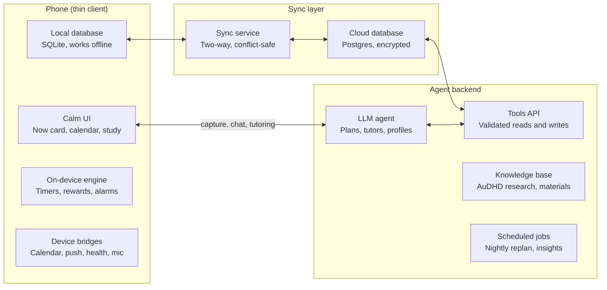

# 9. Architecture

[← Design index](../design.md)

> **Under review.** This section describes the original cloud-agent design. The [technology validation](../technology/README.md) proposes a local-first alternative: an on-device LLM ([T3](../technology/local-llm.md)), sync through the user's Google Drive instead of a cloud Postgres ([T4](../technology/google-sync.md)), and a shared Rust core ([T1](../technology/rust.md), [T2](../technology/app-and-web.md)). If those spikes pass, the agent moves onto the device, the Tools API becomes an in-process interface, and a cloud model is used only for opt-in heavy jobs ([T7](../technology/cloud-llm.md)). This page will be rewritten once the spikes report.

Prism is local-first: the phone holds a full copy of the user's data and runs everything that must be instant or reliable (timers, alarms, reward animations, the current plan), while an LLM agent in the cloud makes every judgement call and writes its decisions back through a validated tools API.

The phone never talks to the database directly from the agent's side: the agent reads and writes only through the Tools API, and the sync service carries those changes to the phone.

**What is code vs what is LLM**

| Deterministic app code | Delegated to the LLM |
| --- | --- |
| Storing and syncing data | Classifying captured text into events, tasks, quests |
| Firing scheduled notifications and alarms | Choosing when and how to nudge, and the wording |
| Timers, XP arithmetic, reward animations | Deciding XP difficulty multipliers for a task |
| Calendar import, time arithmetic | Building and re-planning the daily plan |
| Rendering the Now card, quest map, calendar | Breaking tasks into steps; the Smaller button |
| Spaced-repetition interval maths (FSRS) | Building the knowledge map, generating lessons and questions, grading free answers, tutoring |
| Event logging | Inferring trait updates, writing weekly insights, picking state mode |
| Journal storage, private-entry exclusion, evidence removal on delete | Acknowledging journal entries, tagging them, inferring state from them, choosing wins to resurface |
| Safety cut-offs (crisis keywords route to resources) | Tone, framing and interest hooks |

**Agent design**

- **Orchestrator + tools.** One agent loop with typed tools: `get_profile`, `get_state`, `get_calendar`, `list_tasks`, `upsert_task`, `propose_plan`, `schedule_nudge`, `search_material`, `create_lesson`, `grade_answer`, `propose_trait_update`, `log_insight`. All outputs are JSON-schema validated before they touch the database.
- **Context assembly.** Each call gets a compact context: profile summary, current state, today's calendar, the relevant quest, and retrieved knowledge-base snippets (RAG over the AuDHD knowledge base and the user's materials). Stable parts (system prompt, knowledge base, profile) are prompt-cached to cut cost and latency.
- **Model tiers.** A fast, cheap model (e.g. Claude Haiku 5.5) for capture, step splitting and nudge wording; a mid model (e.g. Claude Sonnet 5.5) for daily planning and tutoring; a top model (e.g. Claude Opus 5.5) for heavy one-off work such as building a knowledge map from a whole course, run as a background job.
- **Triggers.** User actions (capture, Smaller, chat), scheduled jobs (morning plan, nightly re-plan and trait inference, weekly insight), and state changes (check-in, missed window).
- **Plan diffs.** The agent never silently rewrites the plan. It writes a *plan diff* (added, moved, dropped, with a one-line reason) which the app shows as a small announcement; big diffs need user confirmation.

**Offline and latency**

- The agent keeps a buffer on the device: today's plan, pre-split versions of the next 20 steps (so Smaller is instant), and the next 2 days of flashcards and bite cards.
- Offline, the app works from the buffer and queues LLM requests; nothing user-facing blocks on the network.
- Target: any tap responds in under 100 ms locally; LLM-backed responses stream within 2 s.

**Data and sync.** SQLite on device, Postgres in the cloud, synced by a local-first sync engine (candidates: PowerSync, ElectricSQL, or a CRDT layer). The event log is append-only, so most data never conflicts; for editable records the rule is field-level last-writer-wins, and user edits always beat agent edits.

**Agent guardrails**

- The agent cannot delete user data, only archive it; deletes are user-only.
- Uploaded material and calendar text are treated as untrusted data, never instructions (prompt-injection defence).
- Rate and cost limits per user per day, with graceful fallback to the on-device buffer.
- Every agent decision is logged with its inputs for debugging and for the user's "why did you do this?" view.
