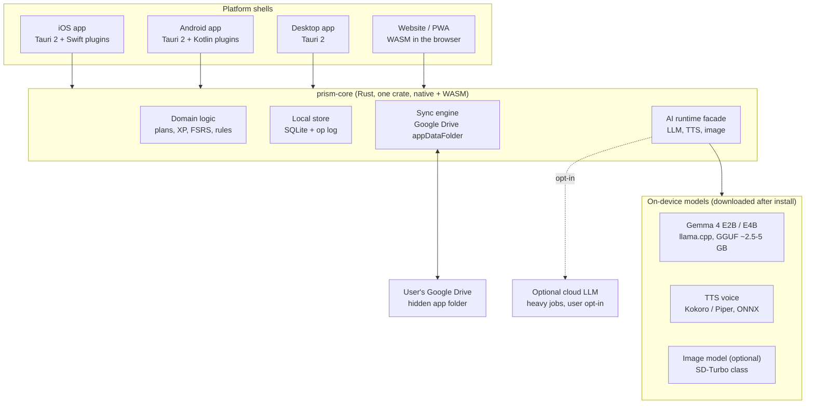

# 14. Technology validation

[← Design index](../design.md)

This section checks whether the proposed technology choices can deliver the design, using desk research first and short, time-boxed spikes second. Each document ends with a verdict and the spike that would settle any remaining doubt. Status reflects desk research as of Oct 31, 2026; nothing has been prototyped yet, and version-specific claims should be re-checked when each spike starts.

## Choices under validation

| # | Choice | Document | Desk verdict | Biggest risk |
| --- | --- | --- | --- | --- |
| T1 | Rust as the main language | [rust.md](rust.md) | **Go** | Mobile OS features (alarms, widgets, lock-screen actions) still need Swift and Kotlin glue |
| T2 | One codebase for the app and the website | [app-and-web.md](app-and-web.md) | **Go, with a reduced web tier** | Browsers cannot run alarms, background jobs or large local models reliably |
| T3 | Local LLM (Gemma 4) | [local-llm.md](local-llm.md) | **Go for light tasks, hybrid for heavy ones** | Small on-device models are weaker at planning, long-document work and reliable tool calls |
| T4 | Google Drive as the sync layer | [google-sync.md](google-sync.md) | **Go, with conditions** | No server copy of the data, so cloud agent jobs need a new design |
| T5 | Local text to speech | [local-tts.md](local-tts.md) | **Go** | Voice quality varies by language; model download size |
| T6 | Local image generation | [local-image-generation.md](local-image-generation.md) | **Partial: optional, not core** | Download size, battery and heat on phones; weak in browsers |

## Target stack if every validation passes

The UI and all business rules live in Rust and are shared; each platform shell adds only what the OS forces to be native (notifications, alarms, widgets, calendar access, background scheduling).

## Cross-cutting findings

**The local choices change the architecture.** The current [architecture](../design/architecture.md) assumes a cloud agent that reads and writes a cloud Postgres database. Choosing a local LLM and Google Drive sync moves most of the "brain" onto the device and removes the server-side database. Consequences:

- Nightly jobs (re-plan, trait inference, weekly insights) run on the device, during OS-granted background windows (iOS `BGProcessingTask`, Android `WorkManager`), ideally while charging. On the web they run when the tab is open.
- The agent's tools API becomes an in-process Rust interface instead of a network service. JSON-schema validation of agent output stays, and becomes more important with smaller models.
- An optional cloud model remains useful for heavy, one-off work (building a knowledge map from a whole course). It must be opt-in, because it breaks the "data never leaves your devices or your Drive" promise that the local stack otherwise allows.

**Device budget.** Models cannot all be in memory at once on a phone. Rough sizes at useful quality:

| Model | Download | RAM while running | Load policy |
| --- | --- | --- | --- |
| LLM, Gemma 4 E2B / E4B, 4-bit | 2.5 to 5 GB | 3 to 5 GB | Load on demand, unload after idle |
| TTS voice | 80 to 350 MB | 0.2 to 0.5 GB | Can stay loaded during audio lessons |
| Image model, SD-Turbo class | 1 to 2 GB | 2 to 3 GB | Only while generating; never alongside the LLM |

Models are downloaded after install, on Wi-Fi by default, with a "lite" mode that skips image generation entirely. Target devices: phones from about 2022 onward with 6 GB of RAM or more; older devices fall back to the platform's built-in model or the optional cloud model.

**Platform-native AI as a fallback tier.** Apple Foundation Models (on-device, iOS 26 and later on Apple Intelligence devices) and Gemini Nano (Android AICore / ML Kit GenAI, selected devices; Chrome's built-in AI APIs on the web) give free, no-download models. They are not Rust and their availability is uneven, but they are worth a thin adapter behind the same AI facade, chosen at runtime.

## How each spike is run

Each spike is time-boxed (2 to 5 days), runs on a fixed device set (a mid-range Android, a recent iPhone, a 5-year-old Android, an M-series Mac, Chrome and Safari), and has written pass/fail criteria before it starts. Results are appended to the relevant document under a "Spike results" heading, and the verdict in the table above is updated.

Suggested order, highest risk first:

1. T2 + T1: Tauri 2 shell with a shared Rust core on iOS, Android and web; a local notification with action buttons fires from Rust.
2. T3: llama.cpp with Gemma 4 E2B / E4B in the shell on both phones; capture classification and "Smaller" with schema-constrained JSON.
3. T4: two devices and a browser syncing through the Drive app folder, with offline edits on both.
4. T5: Kokoro voice reading a bite card on each platform.
5. T6: one SD-Turbo image on each phone, measured for time, heat and battery.
