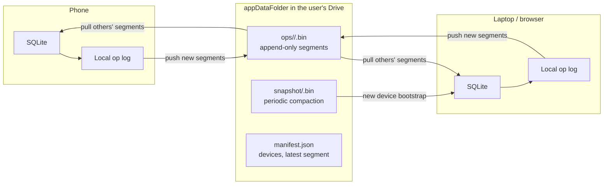

# T4. Google Drive as the sync layer

[← Technology validation](README.md)

**Verdict: Go, with conditions.** Syncing through the user's own Google Drive is feasible and fits a local-first, privacy-first product: Prism stores no user data on its own servers, and the user can see and revoke access from their Google account. It needs a custom sync engine (Drive is file storage, not a database), and it removes the server-side database that the current architecture's cloud agent depends on.

## What "Google sync" should mean

| Option | What it is | Fit |
| --- | --- | --- |
| **Google Drive `appDataFolder`** | A hidden per-app folder in the user's Drive, invisible in the Drive UI, counted against the user's quota, accessible only to Prism | **Recommended.** No Prism backend, user owns the data, works from mobile, desktop and the browser via REST |
| Firebase Firestore | Google-hosted document database with offline sync built in | Data sits in Prism's own cloud project, not the user's; no official Rust SDK; adds hosting cost. A fallback if the Drive approach fails |
| Android Backup / iCloud | OS-level backup | Not cross-platform and not live sync; useful only as disaster recovery |

## Proposed design

- **Operation log, not database files.** Each device writes its own append-only segment files of changes. Devices never overwrite each other's files, so Drive never sees a write conflict.
- **Merge rule.** Matches the existing design: the `Event` log is append-only and never conflicts; editable records use field-level last-writer-wins with hybrid logical clocks; user edits beat agent edits. Automerge is an alternative if rich-text or list merges are needed later.
- **Compaction.** A device periodically writes a snapshot so new devices do not replay the full history; old segments are deleted once every known device has passed them.
- **Change detection.** Poll the Drive `changes` API on app open, on focus, and on a timer while open. Drive push notifications (webhooks) need a public server, so they are out of scope.
- **Encryption.** Encrypt segments client-side before upload, so Google stores ciphertext. The key must reach the user's other devices: either derived from a user passphrase (strongest; lost passphrase means lost data) or stored in the platform keychain with a recovery code. Decide in the spike; this is a usability vs privacy trade-off for a user group that struggles with forgotten passwords.
- **Large files.** Uploaded study material (PDFs, audio) goes into its own Drive files, referenced by ID, not into the op log.

## Platform access

| Platform | Sign-in | API |
| --- | --- | --- |
| Android | Google Sign-In / Credential Manager (Kotlin plugin), scope `drive.appdata` | Drive REST via `reqwest` from Rust |
| iOS | Google Sign-In SDK (Swift plugin) | Drive REST via `reqwest` |
| Desktop | OAuth loopback flow | Drive REST |
| Web | Google Identity Services in the browser | Drive REST from WASM (`fetch`) |

The `drive.appdata` scope is narrow and believed not to require Google's restricted-scope security assessment; confirm against current Google OAuth verification rules before launch.

## Consequences for the rest of the design

- **No server database means no server-side agent.** The cloud agent, Postgres and Tools API in the [architecture](../design/architecture.md) are replaced by the on-device agent from [local-llm](local-llm.md). If an opt-in cloud model is used, the device sends it only the context for one request.
- **Users need a Google account.** Offer a local-only mode (no sync) for users who decline; Apple users without Google accounts are the main concern.
- **Quota.** The app folder counts against the user's 15 GB free quota; op log plus snapshots should stay in single-digit MB, study material is the real cost.
- **Latency.** Sync is near-real-time while the app is open and catches up on open otherwise. That is fine for a personal app; it rules out live shared features (body-doubling rooms, accountability buddy) through this channel. Those would need a separate small service later.

## Risks

| Risk | Mitigation |
| --- | --- |
| Clock skew causes wrong last-writer-wins outcomes | Hybrid logical clocks, not wall clocks |
| Drive API rate limits with frequent polling | Batch segments (e.g. one per 30 s of activity); back off on idle |
| Lost encryption key means lost data | Recovery code shown at setup, plus optional unencrypted export |
| Google changes OAuth policy or scope classification | Keep the sync engine behind a `SyncBackend` trait; Firestore or a self-hosted backend could slot in |
| Partial uploads or corrupt segments | Content hashes in the manifest; segments are idempotent to replay |

## Spike

Implement the op log and a `SyncBackend` for Drive `appDataFolder`. Run two phones and one browser; make conflicting offline edits on all three to the same task, then reconnect.

Pass: all three converge to the same state within 30 s of reconnecting; user edit wins over agent edit in every case; a new device bootstraps 10,000 events in under 10 s; data in Drive is unreadable without the key.
